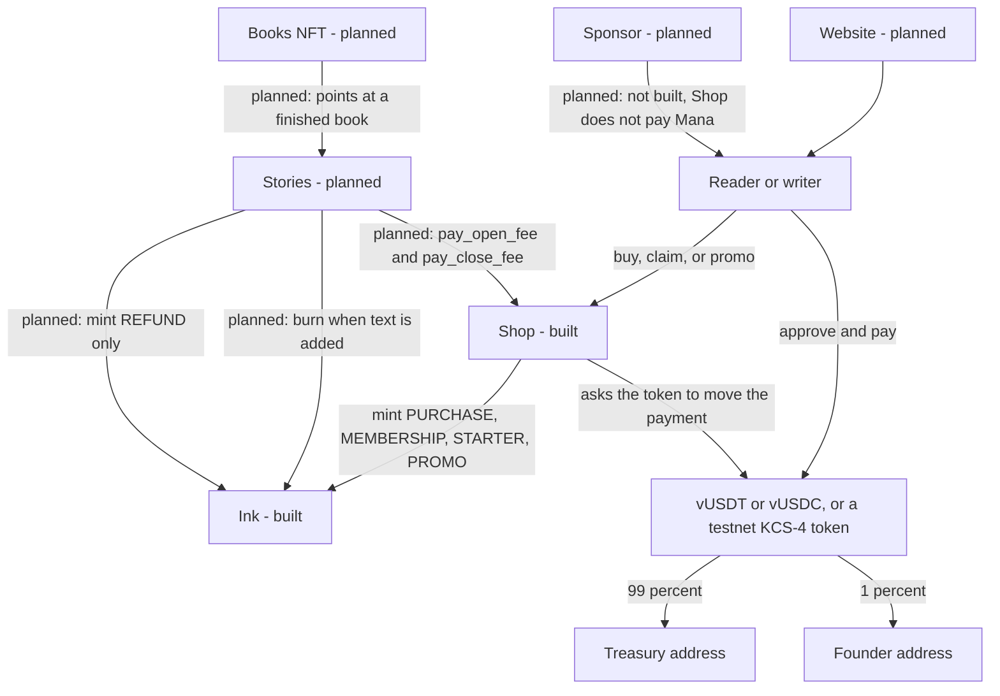

# SwarmTales

SwarmTales is a group-story project for the Koinos blockchain. People subscribe, receive a writing allowance called Ink, and spend it to add to or edit stories. Public stories are open to contributors. Private books are invite-only.

**This code is unaudited and is not deployed to Koinos mainnet.** The tests run in a mock chain on a computer. They do not spend tokens. Do not put real money into these contracts until someone qualified has reviewed them and Carl has accepted the open decisions below.

## What you can do today, and what is still a plan

Two contracts exist in this repository and have passing tests: **Ink** and **Shop**.

| Piece | Status |
|---|---|
| Ink, the non-transferable writing allowance | Built and tested (41 checks) |
| Shop, the cash register for memberships, packs, story fees, and promo codes | Built and tested (39 checks) |
| A practice stablecoin inside this repo | Not included. On testnet, deploy the official Koinos token and point Shop at it |
| Stories (the books themselves, trials, the 3-project limit, archive, refunds) | Planned |
| Sponsor (paying Mana for someone else) | Planned |
| Books NFT | Planned |
| Website | Planned |

The prices and rules in the next sections are the design Carl confirmed. Shop can charge those prices, but the numbers are **not hardcoded**. An admin enters them after upload. Stories rules such as character limits are **not enforced yet**, because the Stories contract does not exist.

## How it works

A reader pays for a month and can read. A reader does not receive Ink.

A writer pays for a month and receives Ink. **1 INK = 1 character.** Ink is not money. It cannot be sent to someone else, sold, or traded. Spending it means a future Stories contract burns it when that person adds or edits text. That burn is not built yet.

Public stories are the ones any allowed writer can add to. Private books are invite-only. Both of those live in the planned Stories contract. Shop only collects the open and close fees when Stories asks it to.

### A payment, in one transaction

1. The buyer approves Shop, on the stablecoin, for the full price, and signs the Shop call.
2. Shop tells the stablecoin to pay the treasury and the founder.
3. If the purchase includes Ink, Shop asks the Ink contract to mint it.
4. If any step fails, the whole transaction rolls back. Shop never holds the money and has no withdraw function.

The founder share is `floor(price × fee / 10,000)`. The treasury gets the rest, so the two parts add up to the price. The fee starts at **100** (1%) and the contract refuses a fee above **500** (5%).

## Economics

Mainnet tokens, read from `https://api.koinos.io` on 19 October 2026. They are documented here and entered later with `set_asset`. They are not written into the contract logic.

| Token | Address | Name on chain | Decimals |
|---|---|---|---|
| vUSDT | `12VoHz41a4HtfiyhTWbg9RXqGMRbYk6pXh` | Vortex Tether USD | 8 |
| vUSDC | `1N8iYrYEJdCVK1rhbqv3qZUzHcpoeKmFnj` | Vortex USD Coin | 8 |

Both use 8 decimal places, so **$1.00 = 100,000,000** base units. Read `decimals` again before setting live prices.

| Item | Starting price | Ink | Where it lives |
|---|---|---|---|
| Reader, one month | $1 | none | Shop, built. Admin sets the price |
| Writer, one month | $5 | 15,000 per month | Shop, built. First month mints immediately. Later months are claimed |
| Pack S, Writers only | $2 | 5,000 | Shop, built. Mint reason PURCHASE |
| Pack M | $5 | 15,000 | Shop, built |
| Pack L | $12 | 45,000 | Shop, built |
| Open a Book | $20 | 20,000 starter Ink | Shop collects this only when Stories calls it. Stories is planned |
| Close a Book | $5 | none | Same |
| Open a Short Story | $10 | 10,000 starter Ink | Same |
| Close a Short Story | $2 | none | Same |
| Book length | 100,000 to 1,000,000 characters | — | Planned, in Stories |
| Short Story length | 10,000 to 99,999 characters | — | Planned, in Stories |
| Promo campaign | free Ink, for example 1,000 | reason PROMO | Shop, built. No public "claim" button |
| Trial writing | about 1,000 characters | — | Planned, in Stories. Shop only records whether a wallet has claimed a promo |
| Open projects | 3 per wallet | — | Planned, in Stories |
| Auto-archive | 60 days | — | Planned, in Stories |

Writer claims are allowed every **30 days** (2,592,000 seconds). That wait is part of the contract, so an admin cannot shorten it. One purchase can be at most **24 months**. The Ink amount is locked when the Writer term starts. Changing the catalog later does not shrink months already paid for. When `paid_until` has passed, unclaimed months from that term are gone. An active Writer term cannot be replaced by a Reader purchase.

### Promo codes

There is no open claim button. An admin creates a campaign with a code, an Ink amount, a total budget, an optional daily cap (`0` means no daily cap), and a start and end. A global switch can turn every campaign off. Each wallet can claim **once, ever**, across every campaign. Optional single-use codes each work once, and that wallet still cannot claim again. The mint note is `campaign:<id>`. `get_promo_claimed` returns that campaign id, or 0 if the wallet has never claimed.

A code sent in an admin transaction is public, because the chain is public.

## Architecture



Shop does not mint Ink by itself. It calls Ink, and Ink checks that Shop was allowed that reason. Nobody, including the admin, can mint by calling Ink directly.

| Contract | What it is responsible for |
|---|---|
| Ink | Balances, supply, mint reasons, burn. No transfers |
| Shop | Prices, the payment split, memberships, packs, promo, and the calls that mint Ink |
| Test stablecoin | Not in this repo. Use the official Koinos KCS-4 token on testnet. SDK 1.0.0 cannot build a safe token, because it lacks the allowance check a real token needs |
| Sponsor | Planned. Would pay Mana for a user. Shop does not do this |
| Stories | Planned. Books, chapters, the trial, the 3-open limit, the 60-day archive, private invites, and refunds |
| Books NFT | Planned. A collectible for a finished book. Not a way to transfer Ink |
| Website | Planned. The pages a reader or writer would use |

## Security model

Ink cannot be transferred. There is no transfer, approve, or allowance function on Ink.

**Who can mint.** Only a contract the Ink admin has approved, and only for the reasons in its mask. The Shop mask is **30**, which is PURCHASE (1), MEMBERSHIP (2), STARTER (3), and PROMO (4). Stories, when it exists, should be approved for REFUND (5) only. A direct call from a wallet has no calling contract, so it cannot mint.

**Who can burn.** An approved burner contract, and the Ink owner's signature on that same transaction. The admin cannot burn someone's Ink. Pause blocks mint and burn. It does not block the admin, so the admin can unpause.

**Who can move the stablecoin.** Shop asks the token to transfer from the buyer to the treasury, then to the founder. The buyer must have approved Shop and must have signed. A stranger cannot spend a leftover approval. Shop has no function that sends funds anywhere else, and it refuses to set the treasury or the founder to the Shop contract itself.

**Admin.** Until `set_admin`, the contract's own address is the admin, and every admin action needs that address's signature. The admin of Ink can appoint minters and burners, pause, and hand admin on. The admin of Shop can change future prices, the fee from 0% to 5%, the treasury and founder addresses, the Ink and Stories addresses, and promo campaigns. The admin cannot take back a payment that already split.

**Payment addresses are configuration, not code.** vUSDT and vUSDC above are the mainnet values to type in. A testnet uses different token addresses. Carl's testnet wallet `1MQ3RLVouWSJQ6RYkvHHxfBkwmi4j2WCEW` is in `deploy/testnet.env.example` only. It is not inside either contract.

**Upgrades.** Koinos stores a contract at an address. Uploading again to that same address replaces the code and keeps the storage. These contracts do not have a separate proxy. Leave the three upload overrides **false** (`upload file.wasm file.abi false false false`). That leaves future uploads, and contract-call authority, with the key of the contract address. `set_admin` does not remove that key's power to replace the wasm. If the storage layout changes in a later version, old data can be read wrong. Do not turn the authorize override on unless a reviewed `authorize` function exists. Turning it on without one can freeze the contract.

**What the tests do not prove.** The mock chain does not run the real stablecoin or the real Ink wasm. Shop tests check the exact call bytes and roll back when a call returns a failure. A real testnet rehearsal is still required. The reentrancy lock is in the code and was not executed against a malicious token.

## Repository layout

| Path | What it is |
|---|---|
| `assembly/Ink.ts` | The Ink contract |
| `assembly/proto/ink.proto` | Ink's functions and events |
| `assembly/__tests__/Ink.spec.ts` | Ink tests |
| `shop/assembly/Shop.ts` | The Shop contract |
| `shop/assembly/proto/shop.proto` | Shop's functions and events |
| `shop/assembly/__tests__/Shop.spec.ts` | Shop tests |
| `deploy/testnet.env.example` | Public testnet addresses. Copy to `deploy/testnet.env` to edit |
| `deploy/prepare-testnet.js` | Builds release files and prints upload steps. It does not upload |
| `scripts/patch-protoc-stdin.js` | A small fix so the code generators work on Node.js 20 and later |

Each contract folder has its own `package.json` and `yarn.lock`. This is not a Yarn workspace. The project names are `ink` and `shop` because the Koinos tool only allows lowercase letters, numbers, and underscores.

These files are recreated by the build. Do not edit them, and they are not stored in git.

- `assembly/proto/ink.ts`, `shop/assembly/proto/shop.ts`
- `assembly/Ink.boilerplate.ts`, `shop/assembly/Shop.boilerplate.ts`
- `assembly/index.ts`, `shop/assembly/index.ts`
- `abi/*.abi`, `abi/*-abi.json`
- `build/`

## Prerequisites and build

Install [Node.js](https://nodejs.org/) 20 or newer, Git, Yarn 1 (classic), and the Koinos contract tool. These contracts were built and tested with Node.js 22.14.0, Yarn 1.22.22, and `@koinos/sdk-as-cli` 1.0.2. `yarn install` also puts SDK 1.0.0 in the project, which is the version the template pins. Do not use Yarn 2 or later. The Koinos tools call `yarn`.

### Windows (PowerShell)

```powershell
Set-ExecutionPolicy -Scope CurrentUser RemoteSigned
npm install -g yarn
npm install -g @koinos/sdk-as-cli
yarn -v
koinos-sdk-as-cli -V
```

`yarn -v` should print `1.x.x`. `koinos-sdk-as-cli -V` should print `1.0.2` or another 1.0.x. PowerShell was not available on the machine that ran the tests. The commands are the same ones PowerShell runs.

### Linux and macOS

```bash
npm install -g yarn
npm install -g @koinos/sdk-as-cli
yarn -v
koinos-sdk-as-cli -V
```

If `npm install -g` says "permission denied", install into a folder you own instead of using sudo:

```bash
mkdir -p "$HOME/.local"
npm install -g yarn @koinos/sdk-as-cli --prefix "$HOME/.local"
export PATH="$HOME/.local/bin:$PATH"
```

### Ink

From this folder, the one that contains `assembly/Ink.ts`:

```bash
yarn install
yarn build:debug
yarn test
```

`yarn build:debug` is `koinos-sdk-as-cli build-all debug 0 ink.proto`. The `0` is not a version. Leaving it out makes the tool print help and stop. `yarn install` runs `scripts/patch-protoc-stdin.js`, which keeps the code generators from crashing with `EAGAIN` on Node.js 20 and later.

Success means `build/debug/contract.wasm` exists and the test report ends with **41 pass** and **0 fail**.

### Shop

```bash
cd shop
yarn install
yarn build:debug
yarn test
```

Success means `shop/build/debug/contract.wasm` exists and the test report ends with **39 pass** and **0 fail**.

`yarn build:release` in either folder makes the smaller wasm used for an upload. Tests use the debug build.

## Testnet

You do not need testnet coins to build or to run the tests. Do not run a testnet node next to production nodes.

The admin wallet in the example config is `1MQ3RLVouWSJQ6RYkvHHxfBkwmi4j2WCEW`. Copy `deploy/testnet.env.example` to `deploy/testnet.env` if you want to change a public address. Never put a private key, seed phrase, or password in that file. The prepare script stops if it sees one.

On Koinos, the address you upload from **becomes** the contract. Do not upload Ink or Shop onto the admin wallet. Create a new wallet for Ink and another for Shop. Keep those seeds yourself. After each upload, while that new wallet is open, call `set_admin` with the admin address.

```bash
node deploy/prepare-testnet.js
```

That builds both release files and prints the commands. It does not connect to a wallet. You upload yourself with [Koinos CLI](https://docs.koinos.io/developers/cli/). Pass `false false false` as the three overrides.

Mana is not a separate coin, and there is no mana faucet. Mana refills from the test KOIN on the address that signs. The upload is signed by the new contract wallet, so that wallet needs the coins.

### Free coins on the Foundation testnet

This is the network named in the deploy file. It was answering on 19 October 2026.

- Health: [https://testnet.koinosfoundation.org/health](https://testnet.koinosfoundation.org/health)
- API: `https://testnet.koinosfoundation.org/jsonrpc`
- Chain id that day: `EiAIKVvm6-V2qmsmUvPJy09vCCLbtn9lHFpwrJbcTIEWRQ==`. Read `chain.get_chain_id` again before you upload.
- Bot: [https://t.me/KoinosTestnetFaucetBot](https://t.me/KoinosTestnetFaucetBot)

You have to request the coins yourself. Open the bot, send `/start`, then send one address per message:

```text
/faucet 1MQ3RLVouWSJQ6RYkvHHxfBkwmi4j2WCEW
```

The bot's guide says each claim sends **100 vKOIN**, with a 24-hour cooldown per Telegram user and per address, and a daily cap of 10,000. Check with `/balance`. Source: [koinos/koinos-testnet faucet](https://github.com/koinos/koinos-testnet/blob/main/docs/faucet.md).

The upload spends mana on the contract wallet, not on the admin wallet. Practical order: claim to the new Ink address and upload Ink, claim to the new Shop address the next day and upload Shop, then claim to `1MQ3RLVouWSJQ6RYkvHHxfBkwmi4j2WCEW` so the admin wallet can call `set_minter` and `set_addresses`. If the bot is silent, ask in [https://t.me/koinos_community](https://t.me/koinos_community).

### Harbinger is a different chain

[Harbinger](https://docs.koinos.io/developers/testnet/) is the Koinos Group testnet. Its docs say to join [https://discord.gg/gMGMADsmfk](https://discord.gg/gMGMADsmfk), open `#faucet` under Developers, and send:

```text
!faucet 1MQ3RLVouWSJQ6RYkvHHxfBkwmi4j2WCEW
!balance 1MQ3RLVouWSJQ6RYkvHHxfBkwmi4j2WCEW
```

The documented reply is 100 tKOIN. Those coins do not appear on the Foundation testnet, and Foundation vKOIN does not appear on Harbinger. On 19 October 2026 the public Harbinger APIs did not answer from the machine that checked. If the Discord bot is silent, ask in that server.

Do not point Shop at mainnet vUSDT while you are on a testnet. Those contracts are not there. Deploy the official KCS-4 token, mint test units to yourself, then `set_asset` that address and set prices in **that** token's base units.

## Roadmap

1. Ink. Done and tested.
2. Shop. Done and tested.
3. Testnet rehearsal. Not started. Needs faucet coins, two fresh contract wallets, and a practice KCS-4 token. Carl does the wallet steps.
4. Stories. Not started. This is the contract that would enforce the trial, the 3-open limit, character ranges, private invites, the 60-day archive, and refunds.
5. Website. Not started.
6. Sponsor and Books NFT. Not started. They are not required for the first public story.
7. An independent audit, then a mainnet upload. Not started.

Nothing here has been audited. Nothing has been uploaded to testnet or mainnet by this repository's tooling.

## Open decisions

These are still Carl's to make. The code was not changed to guess them.

1. **Supply cap.** Ink has no maximum supply. Any approved minter can mint until someone pauses it.
2. **`BURN_OTHER`.** Burn reason 2 is accepted as well as "contribution", as long as a burner contract is approved and the owner signed. It is reserved for a future feature and is not used by Shop.
3. **SDK pin.** The contracts stay on `@koinos/sdk-as` 1.0.0 because that is what the official template installs. A newer SDK exists and was not adopted.
4. **Emoji counting.** Ink's public note is limited to 64 UTF-16 code units, so one emoji can count as two toward that note. Story text is not counted here. When Stories is built, Carl still needs to decide whether an emoji in a story costs one Ink or more.

Other choices already built, which Carl can still change before an upload by asking for a new version:

- Writer claims are every 30 days, and that number is not an admin setting.
- One membership purchase can be at most 24 months.
- The Writer Ink rate is locked for the whole active term, including an extension.
- Unclaimed months are forfeited when `paid_until` passes.
- One promo claim per wallet, forever.
- A campaign's code, amount, and single-use setting cannot be edited after creation. Budget, daily cap, end date, and on/off can.
- The fee is 0% to 5%, starting at 1%. Rounding leftovers go to the treasury.

## License

No license has been chosen. The `license` field in `package.json` and `shop/package.json` still says `MIT` because the Koinos project template wrote that. That is not a decision by Carl. Do not treat this repository as MIT, or as any other license, until Carl picks one and a `LICENSE` file is added.

## Disclaimer

SwarmTales is unaudited experimental software. It is not deployed to Koinos mainnet. Ink is a usage allowance for writing. It has no cash value, cannot be transferred, sold, redeemed, or traded, and is not an investment. Stablecoin payments are the only money in this design, and the founder fee is meant to be shown to a buyer before they pay. Testnet coins are play money on a network that can be reset.
