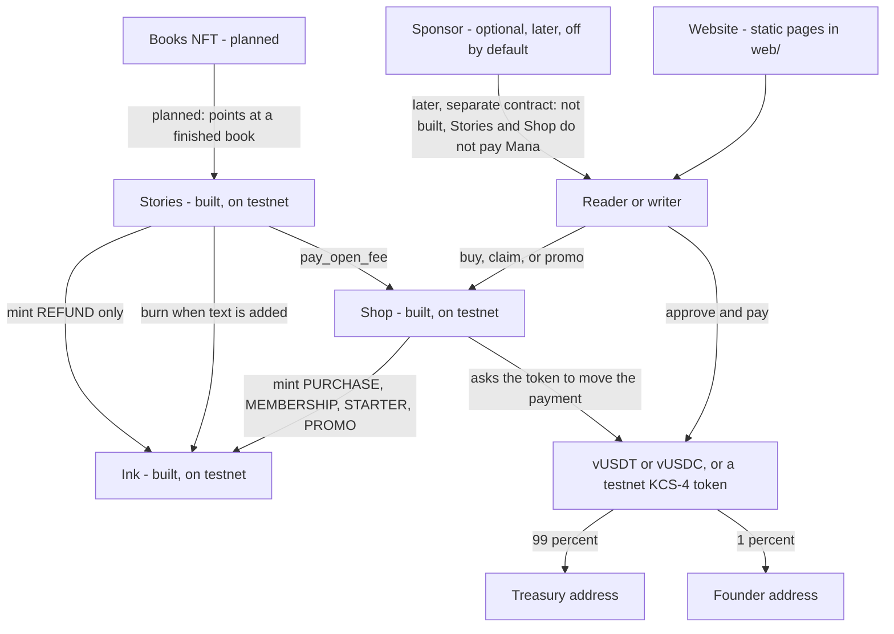

# SwarmTales

SwarmTales is a group-story project for the Koinos blockchain. People subscribe, receive a writing allowance called Ink, and spend it to add to or edit stories. Public stories are open to contributors. Private books are invite-only.

**This code is unaudited and is not deployed to Koinos mainnet.** The tests run in a mock chain on a computer. They do not spend tokens. Do not put real money into these contracts until someone qualified has reviewed them and Carl has accepted the open decisions below.

## What you can do today, and what is still a plan

Three contracts exist in this repository and have passing tests: **Ink**, **Shop**, and **Stories**. All three are on the Koinos Foundation testnet. They are not on mainnet. The website in `web/` reads those testnet contracts from a browser. How to run it is in [docs/UI.md](docs/UI.md).

| Piece | Status |
|---|---|
| Ink, the non-transferable writing allowance | Built and tested (53 checks) |
| Shop, the cash register for memberships, packs, story fees, and promo links | Built and tested (89 checks) |
| A practice stablecoin inside this repo | Not included. On testnet, deploy the official Koinos token and point Shop at it |
| Stories (the books themselves, trials, open-project limits, archive, refunds, moderation) | Built and tested in the mock chain. The 2026-10 audit fixes need a fresh testnet deploy (the testnet is being reset) |
| Sponsor (paying Mana for someone else) | Optional, later, a separate contract, OFF by default. Not in Stories |
| Books NFT | Planned |
| Website | Static pages in `web/`. Reads the testnet. GitHub Pages publishing needs one repo setting (see docs/UI.md) |

The prices and rules in the next sections are the design Carl confirmed. Shop can charge those prices, but the numbers are **not hardcoded**. An admin enters them. On the Foundation testnet, Stories is uploaded and wired to Ink and Shop, so the chain enforces those rules there. Mainnet is still not deployed.

## How it works

A reader pays for a month and can read. A reader does not receive Ink.

A writer pays for a month and receives Ink. The token a wallet shows is **SwarmTales Ink**. That name is final. Ink is not money. It cannot be sent to someone else, sold, or traded. Spending it means the Stories contract burns it when that person adds text. If an editor shortens or removes that text, Stories refunds the difference to the original author.

Story text is charged per UTF-16 code unit ("text unit"). A normal letter costs 1 Ink. Most emoji cost 2 Ink, because each is stored as two code units. A few older emoji such as ⭐ cost 1. A skin-tone emoji such as 👍🏽 or a flag such as 🇺🇸 costs 4. A family such as 👨‍👩‍👧 costs 8. The Stories contract counts this itself and refuses the text if the website's preview (`expected_ink`) disagrees, so nobody is charged a surprise amount. Ink's own public note is a separate limit of 64 UTF-16 code units.

Public stories are the ones any allowed writer can add to. Private books are invite-only. Both of those live in the Stories contract. Shop only collects the open fee when Stories asks it to. Closing a story is free.

### A payment, in one transaction

1. The buyer approves Shop, on the stablecoin, for the full price, and signs the Shop call.
2. Shop tells the stablecoin to pay the treasury and the founder.
3. If the purchase includes Ink, Shop asks the Ink contract to mint it.
4. If any step fails, the whole transaction rolls back. Shop never holds the money and has no withdraw function.

The founder share is `floor(price × fee / 10,000)`. The treasury gets the rest, so the two parts add up to the price. The fee starts at **100** (1%) and the contract refuses a fee above **500** (5%).

## Economics

Mainnet tokens, read from `https://api.koinos.io` on 19 October 2026. They are documented here and entered later with `set_asset`. They are not written into the contract logic.

| Token | Address | Name on chain | Decimals |
|---|---|---|---|
| vUSDT | `12VoHz41a4HtfiyhTWbg9RXqGMRbYk6pXh` | Vortex Tether USD | 8 |
| vUSDC | `1N8iYrYEJdCVK1rhbqv3qZUzHcpoeKmFnj` | Vortex USD Coin | 8 |

Both use 8 decimal places, so **$1.00 = 100,000,000** base units. Read `decimals` again before setting live prices.

| Item | Starting price | Ink | Where it lives |
|---|---|---|---|
| Reader, one month | $1 | none | Shop, built. Admin sets the price |
| Writer, one month | $5 | 15,000 per month | Shop, built. First month mints immediately. Later months are claimed |
| Pack S, Writers only | $2 | 5,000 | Shop, built. Mint reason PURCHASE |
| Pack M | $5 | 15,000 | Shop, built |
| Pack L | $12 | 45,000 | Shop, built |
| Open a Book | $20 | 20,000 starter Ink | Shop collects this only when Stories calls it |
| Close a Book | $5 | none | Same |
| Open a Short Story | $10 | 10,000 starter Ink | Same |
| Close a Short Story | $2 | none | Same |
| Book length | 100,000 to 1,000,000 characters | — | Stories, built |
| Short Story length | 10,000 to 99,999 characters | — | Stories, built. Can close from 10,000 |
| Promo campaign | free Ink, for example 1,000 | reason PROMO | Shop, built. No public "claim" button |
| Trial writing | 1,000 characters per wallet, ever | — | Stories, built. Needs a claimed promo. Shop only records the claim |
| Open projects | 3 per wallet | — | Stories, built |
| Auto-archive | 60 days | — | Stories, built. One free revive |
| Per-submission cap | 6,000 | — | Stories, built. Admin can set 100 to 6,000 |

Writer claims are allowed every **30 days** (2,592,000 seconds). That wait is part of the contract, so an admin cannot shorten it. One purchase can be at most **24 months**. The Ink amount is locked when the Writer term starts. Changing the catalog later does not shrink months already paid for. When `paid_until` has passed, unclaimed months from that term are gone. An active Writer term cannot be replaced by a Reader purchase.

### Promo codes

There is no open claim button. An admin creates a campaign with a code, an Ink amount, a total budget, an optional daily cap (`0` means no daily cap), and a start and end. A global switch can turn every campaign off, and each campaign has its own switch. Each wallet can claim **each campaign once**; a new campaign can be claimed again. Optional single-use codes each work once, and that wallet still cannot claim the same campaign again. The mint note is `campaign:<id>`. `get_campaign_claimed` says whether a wallet claimed a given campaign; `get_promo_claimed` returns the newest campaign id it claimed, or 0 if it never claimed one (Stories reads this for the trial). On mainnet the admin runs `deploy.js promo-new`, `promo-on`, `promo-off` and `promo-end <id>`.

A code sent in an admin transaction is public, because the chain is public.

## Architecture



Shop does not mint Ink by itself. It calls Ink, and Ink checks that Shop was allowed that reason. Nobody, including the admin, can mint by calling Ink directly.

| Contract | What it is responsible for |
|---|---|
| Ink | Balances, supply, mint reasons, burn. No transfers |
| Shop | Prices, the payment split, memberships, packs, promo, and the calls that mint Ink |
| Test stablecoin | Not in this repo. Use the official Koinos KCS-4 token on testnet. SDK 1.0.0 cannot build a safe token, because it lacks the allowance check a real token needs |
| Sponsor | Optional and later. A separate contract, OFF by default, that could pay Mana for a user. Kept out of Stories so a bug in it can never reach Ink or refunds |
| Stories | On the Foundation testnet (`stories/`). Books, chapters, the trial, open-project limits, the 60-day archive, private invites, editing, paid changes, moderation, the final edit, and refunds |
| Books NFT | Planned. A collectible for a finished book. Not a way to transfer Ink |
| Website | Static files in `web/`. A browser talks to the public testnet node. See [docs/UI.md](docs/UI.md) |

## Security model

> **October 2026 security review.** A review added five hardening changes, all on the
> `security/authorization-and-signed-links` branch: every user and admin action must be
> called **directly** by the transaction, never relayed through another contract (so an app a
> user signed for cannot act in their name); invites and promos are **signed links** (only a
> public key is stored on chain, and a claim is bound to the claimer's wallet); Shop verifies a
> payment by **reading balances before and after**, not by trusting the token's reply; the final
> edit skips removed text in **bounded** steps; and new text must be at least 20 Ink units.
> Key management (separate hardware-wallet keys, published wasm hashes) remains a hard
> prerequisite before mainnet.

Ink cannot be transferred. There is no transfer, approve, or allowance function on Ink.

**Who can mint.** Only a contract the Ink admin has approved, and only for the reasons in its mask. The Shop mask is **30**, which is PURCHASE (1), MEMBERSHIP (2), STARTER (3), and PROMO (4). Stories is approved for REFUND (5) only: mask **32**. The deploy script's `wire-stories` sets exactly that. A direct call from a wallet has no calling contract, so it cannot mint.

**Who can burn.** An approved burner contract, and the Ink owner's signature on that same transaction. The only valid reason is contribution (1), which is text added to a story. Reason 2 is reserved. A burn that uses it fails with `INK: invalid burn reason`. Shop does not burn. The admin cannot burn someone's Ink. Pause blocks mint and burn. It does not block the admin, so the admin can unpause. A future way to spend Ink has to add a new, clearly named reason in a contract upgrade. It cannot reuse 2.

**Who can move the stablecoin.** Shop asks the token to transfer from the buyer to the treasury, then to the founder. The buyer must have approved Shop and must have signed. A stranger cannot spend a leftover approval. Shop has no function that sends funds anywhere else, and it refuses to set the treasury or the founder to the Shop contract itself.

**Admin.** Until a new admin accepts, the contract's own address is the admin, and every admin action needs that address's signature. Admin moves in two steps: `set_admin` only proposes, and the proposed wallet must sign `accept_admin`, so a mistyped address can never become admin. The admin of Ink can appoint minters and burners, pause, and hand admin on. The admin of Shop can change future prices (a purchase names the most the buyer agreed to pay, so a new price never applies mid-purchase), the fee from 0% to 5%, the treasury and founder addresses, the Ink and Stories addresses, and promo campaigns. The admin cannot take back a payment that already split. The full list is in [docs/ADMIN_POWERS.md](docs/ADMIN_POWERS.md), and how the keys are kept is in [docs/KEY_CUSTODY.md](docs/KEY_CUSTODY.md).

**Payment addresses are configuration, not code.** vUSDT and vUSDC above are the mainnet values to type in. A testnet uses different token addresses. Carl's testnet wallet `18MhKFHohFqVNpy7m7XvDRqZgLgVspyRF6` is in `deploy/testnet.env.example` only. It is not inside either contract.

**Upgrades.** Koinos stores a contract at an address. Uploading again to that same address replaces the code and keeps the storage. These contracts do not have a separate proxy. Leave the three upload overrides **false** (`upload file.wasm file.abi false false false`). That leaves future uploads, and contract-call authority, with the key of the contract address. `set_admin` does not remove that key's power to replace the wasm. If the storage layout changes in a later version, old data can be read wrong. Do not turn the authorize override on unless a reviewed `authorize` function exists. Turning it on without one can freeze the contract.

**What the tests do not prove.** The mock chain does not run the real stablecoin or the real Ink wasm. Shop tests check the exact call bytes and roll back when a call returns a failure. A real testnet rehearsal of the legitimate flows is still required. The reentrancy lock and the direct-call rule are in the code; the direct-call rule is exercised by unit tests that set another contract as the caller, but not yet against a live relay on testnet.

## Repository layout

| Path | What it is |
|---|---|
| `assembly/Ink.ts` | The Ink contract |
| `assembly/proto/ink.proto` | Ink's functions and events |
| `assembly/__tests__/Ink.spec.ts` | Ink tests |
| `shop/assembly/Shop.ts` | The Shop contract |
| `shop/assembly/proto/shop.proto` | Shop's functions and events |
| `shop/assembly/__tests__/Shop.spec.ts` | Shop tests |
| `stories/assembly/Stories.ts` | The Stories contract |
| `stories/assembly/proto/stories.proto` | Stories' functions and events |
| `stories/assembly/__tests__/Stories.spec.ts` | Stories tests |
| `docs/STORIES_DESIGN.md` | The Stories design and Carl's decisions |
| `deploy/testnet.env.example` | Public testnet addresses. Copy to `deploy/testnet.env` to edit |
| `deploy/prepare-testnet.js` | Builds release files and prints upload steps. It does not upload |
| `scripts/patch-protoc-stdin.js` | A small fix so the code generators work on Node.js 20 and later |
| `web/` | The static website. No server. See [docs/UI.md](docs/UI.md) |

Each contract folder has its own `package.json` and `yarn.lock`. This is not a Yarn workspace. The project names are `ink`, `shop` and `stories` because the Koinos tool only allows lowercase letters, numbers, and underscores.

These files are recreated by the build. Do not edit them, and they are not stored in git.

- `assembly/proto/ink.ts`, `shop/assembly/proto/shop.ts`, `stories/assembly/proto/stories.ts`
- `assembly/Ink.boilerplate.ts`, `shop/assembly/Shop.boilerplate.ts`, `stories/assembly/Stories.boilerplate.ts`
- `assembly/index.ts`, `shop/assembly/index.ts`, `stories/assembly/index.ts`
- `abi/*.abi`, `abi/*-abi.json`
- `build/`

## Prerequisites and build

Install [Node.js](https://nodejs.org/) 20 or newer, Git, Yarn 1 (classic), and the Koinos contract tool. These contracts were built and tested with Node.js 22.14.0, Yarn 1.22.22, and `@koinos/sdk-as-cli` 1.0.2. The release builds reproduce on Node.js 22 and 24: the same commit gives the same sha256 (see `AUDIT_SCOPE.md`). `yarn install` also puts SDK 1.0.0 in the project, which is the version the template pins. Do not use Yarn 2 or later. The Koinos tools call `yarn`.

### Windows (PowerShell)

```powershell
Set-ExecutionPolicy -Scope CurrentUser RemoteSigned
npm install -g yarn
npm install -g @koinos/sdk-as-cli
yarn -v
koinos-sdk-as-cli -V
```

`yarn -v` should print `1.x.x`. `koinos-sdk-as-cli -V` should print `1.0.2` or another 1.0.x. PowerShell was not available on the machine that ran the tests. The commands are the same ones PowerShell runs.

### Linux and macOS

```bash
npm install -g yarn
npm install -g @koinos/sdk-as-cli
yarn -v
koinos-sdk-as-cli -V
```

If `npm install -g` says "permission denied", install into a folder you own instead of using sudo:

```bash
mkdir -p "$HOME/.local"
npm install -g yarn @koinos/sdk-as-cli --prefix "$HOME/.local"
export PATH="$HOME/.local/bin:$PATH"
```

### Ink

From this folder, the one that contains `assembly/Ink.ts`:

```bash
yarn install
yarn build:debug
yarn test
```

`yarn build:debug` is `koinos-sdk-as-cli build-all debug 0 ink.proto`. The `0` is not a version. Leaving it out makes the tool print help and stop. `yarn install` runs `scripts/patch-protoc-stdin.js`, which keeps the code generators from crashing with `EAGAIN` on Node.js 20 and later.

Success means `build/debug/contract.wasm` exists and the test files together report **53 pass** and **0 fail**.

### Shop

```bash
cd shop
yarn install
yarn build:debug
yarn test
```

Success means `shop/build/debug/contract.wasm` exists and the test files together report **97 pass** and **0 fail**.

### Stories

```bash
cd stories
yarn install
yarn build:release
yarn test
```

Success means `stories/build/release/contract.wasm` exists and the test files together report **381 pass** and **0 fail**.

`yarn build:release` in any of the three folders makes the smaller wasm used for an upload. Tests use the debug build.

### Website, copy checker and deploy tool

Run the website step **first**: `npm test` generates `web/src/generated/`, which the website tests and the copy checker import. Running `node --test` in `web` directly fails until it exists.

```bash
cd web
npm ci
npm test
cd ..
node --test "checker/__tests__/*.test.mjs" "deploy/__tests__/*.test.js"
```

Success means the website reports **161 pass** and the checker and deploy tool **219 pass**, both with **0 fail**. (`yarn test:deploy` in the root `package.json` runs the deploy tool's tests.)

## Testnet

You do not need testnet coins to build or to run the tests. Do not run a testnet node next to production nodes.

The admin wallet in the example config is `18MhKFHohFqVNpy7m7XvDRqZgLgVspyRF6`. Copy `deploy/testnet.env.example` to `deploy/testnet.env` if you want to change a public address. Never put a private key, seed phrase, or password in that file. The prepare script stops if it sees one.

On Koinos, the address you upload from **becomes** the contract. Do not upload a contract onto the admin wallet. Create a new wallet for each of Ink, Shop and Stories, and keep those seeds yourself. Never reuse a contract wallet on another network.

```bash
node deploy/prepare-testnet.js
```

That builds the three release files and prints the `deploy.js` commands, in order: upload each contract, propose and accept the admin, wire them together, and enable the test payment token. It does not connect to a wallet; you run each command and paste a key only at its hidden prompt. The full guide is [docs/TESTNET_DEPLOY.md](docs/TESTNET_DEPLOY.md).

Mana is not a separate coin, and there is no mana faucet. Mana refills from the test KOIN on the address that signs. The upload is signed by the new contract wallet, so that wallet needs the coins.

### Free coins on the Foundation testnet

This is the network named in the deploy file. It was answering on 19 October 2026.

- Health: [https://testnet.koinosfoundation.org/health](https://testnet.koinosfoundation.org/health)
- API: `https://testnet.koinosfoundation.org/jsonrpc`
- Chain id that day: `EiAIKVvm6-V2qmsmUvPJy09vCCLbtn9lHFpwrJbcTIEWRQ==`. Read `chain.get_chain_id` again before you upload.
- Bot: [https://t.me/KoinosTestnetFaucetBot](https://t.me/KoinosTestnetFaucetBot)

You have to request the coins yourself. Open the bot, send `/start`, then send one address per message:

```text
/faucet 18MhKFHohFqVNpy7m7XvDRqZgLgVspyRF6
```

The bot's guide says each claim sends **100 vKOIN**, with a 24-hour cooldown per Telegram user and per address, and a daily cap of 10,000. Check with `/balance`. Source: [koinos/koinos-testnet faucet](https://github.com/koinos/koinos-testnet/blob/main/docs/faucet.md).

The upload spends mana on the contract wallet, not on the admin wallet. Practical order: claim to the new Ink address and upload Ink, claim to the new Shop address the next day and upload Shop, then claim to `18MhKFHohFqVNpy7m7XvDRqZgLgVspyRF6` so the admin wallet can call `set_minter` and `set_addresses`. If the bot is silent, ask in [https://t.me/koinos_community](https://t.me/koinos_community).

### Harbinger is a different chain

[Harbinger](https://docs.koinos.io/developers/testnet/) is the Koinos Group testnet. Its docs say to join [https://discord.gg/gMGMADsmfk](https://discord.gg/gMGMADsmfk), open `#faucet` under Developers, and send:

```text
!faucet 18MhKFHohFqVNpy7m7XvDRqZgLgVspyRF6
!balance 18MhKFHohFqVNpy7m7XvDRqZgLgVspyRF6
```

The documented reply is 100 tKOIN. Those coins do not appear on the Foundation testnet, and Foundation vKOIN does not appear on Harbinger. On 19 October 2026 the public Harbinger APIs did not answer from the machine that checked. If the Discord bot is silent, ask in that server.

Do not point Shop at mainnet vUSDT while you are on a testnet. Those contracts are not there. Deploy the official KCS-4 token, mint test units to yourself, then `set_asset` that address and set prices in **that** token's base units.

## Roadmap

1. Ink. Done and tested.
2. Shop. Done and tested.
3. Testnet rehearsal. The three contracts are on the Foundation testnet and wired together. Mana for a real write was measured outside this page (about 0.09 to 0.58). A signed write from the website still needs Kondor on a computer.
4. Stories. Built and tested in the mock chain. Enforces the trial, open-project limits, character ranges, private invites, the 60-day archive, refunds, moderation, and the UTF-16 Ink charge (most emoji cost 2).
5. Website. A first static site is in `web/`. It can read the testnet. Publishing it is a GitHub Pages setting. See [docs/UI.md](docs/UI.md).
6. Books NFT. Not started. Not required for the first public story.
6a. Sponsor. Optional, later, a separate contract that is OFF by default. Not required.
6b. Reactions and reports. A separate small contract, later.
6c. Keepsake and tip items. A later Shop upgrade.
7. An independent audit, then a mainnet upload. Not started.

Nothing here has been audited. Nothing has been uploaded to mainnet. The Foundation testnet copies were uploaded separately from this website.

## Decisions

### Decided

1. **No maximum supply.** Ink stays uncapped. An approved minter can mint until the admin pauses, or until the amount would overflow a 64-bit total. There is no supply-cap setting to turn on later.
2. **Display name.** Wallets show **SwarmTales Ink**. That name is final. The symbol stays `INK`.
3. **Emoji cost.** Story text is charged per UTF-16 code unit. Most emoji cost 2 Ink; a few older ones such as ⭐ cost 1; skin tones and flags cost 4; a three-person family costs 8. Stories counts it; Ink does not count story text. Ink's on-chain description for the **mainnet** upload says "1 INK per text unit; most emoji cost 2". The Ink already on testnet keeps its older description.
4. **License.** Changed on 19 October 2026. An earlier commit used the Apache License 2.0. That choice is withdrawn. The project is now all rights reserved. The notice is in `LICENSE`. `package.json` and `shop/package.json` say `"license": "UNLICENSED"`, so a package tool will not treat this as open source.
5. **`BURN_OTHER` is removed.** The only valid burn reason is contribution (1). Value 2 is reserved in the proto, including the old name, so it cannot be reused by accident. A later feature that spends Ink adds a new name and a new number, then the contract is upgraded.

### Still open

1. **SDK pin.** The contracts stay on `@koinos/sdk-as` 1.0.0 because that is what the official template installs. A newer SDK exists and was not adopted.

Other choices already built, which Carl can still change before an upload by asking for a new version:

- Writer claims are every 30 days, and that number is not an admin setting.
- One membership purchase can be at most 24 months.
- The Writer Ink rate is locked for the whole active term, including an extension.
- Unclaimed months are forfeited when `paid_until` passes.
- One promo claim per wallet per campaign.
- A campaign's code, amount, and single-use setting cannot be edited after creation. Budget, daily cap, end date, and on/off can.
- The fee is 0% to 5%, starting at 1%. Rounding leftovers go to the treasury.

## License

Copyright (c) 2026 Carl Padavano. All rights reserved.

On 19 October 2026 this replaced an earlier Apache-2.0 choice. The full notice is in `LICENSE`. The source is public so people can read it and check it against contracts that are actually deployed. That is not permission to copy, modify, distribute, sublicense, deploy, or build on it without written permission from Carl Padavano. A GitHub fork, where GitHub's own terms allow one, does not add any other right. Libraries installed by Yarn keep their own licenses. Both `package.json` files say `"UNLICENSED"`.

## Disclaimer

SwarmTales is unaudited experimental software. It is not deployed to Koinos mainnet. Ink is a usage allowance for writing. It has no cash value, cannot be transferred, sold, redeemed, or traded, and is not an investment. Stablecoin payments are the only money in this design, and the founder fee is meant to be shown to a buyer before they pay. Testnet coins are play money on a network that can be reset.
